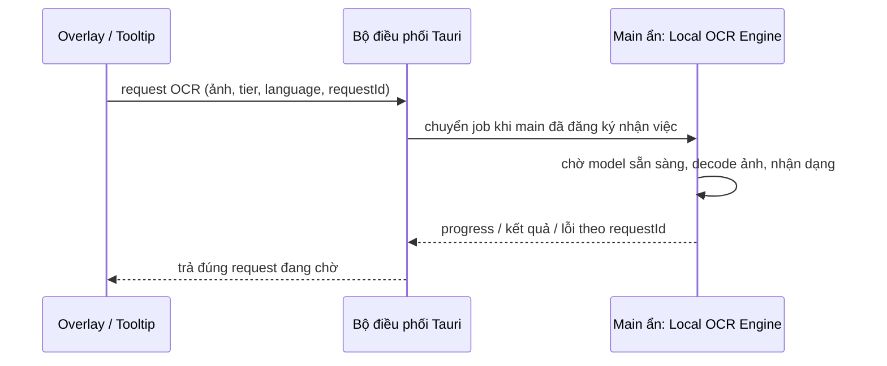

# Giữ Local OCR Engine trong cửa sổ chính

Status: ready-for-agent
Ngày lập: 2026-10-28
Phạm vi hiện tại: lập kế hoạch; chưa thay đổi code ứng dụng.

## Mục tiêu

Trong một phiên chạy app, các lần chụp dùng cùng cấu hình OCR tái sử dụng model đã khởi tạo trong cửa sổ `main` đang ẩn. Đóng Interactive Crop Overlay hoặc Native Tooltip Window không làm mất model. Đổi cấu hình OCR hoặc tắt tự động dịch mới chuyển/giải phóng model.

Giữ nguyên kết quả `fullText`, `blocks` và tọa độ tương đối với ảnh crop, các hành vi dịch, phonetics, ghim ảnh và copy clipboard. OCR tiếp tục chạy offline bằng ONNX Runtime Web.

## Căn cứ từ code hiện tại

- `src/services/ocr.ts`: `activeServicePromise` và `vietOcrSessions` là biến trong từng WebView, không dùng chung giữa các cửa sổ.
- `src-tauri/src/lib.rs`: tạo lại tooltip trong `open_tooltip_window_inner`; `close_overlay` hủy overlay.
- `src/main.ts`: có đường OCR trong overlay khi nhận được ảnh; đường chụp vùng native chuyển ảnh sang tooltip qua `process_crop_area`.
- `src/tooltip.ts`: chạy OCR nếu payload chưa có text nhưng có ảnh.
- `src/main.ts`, `src/tooltip.ts`, `src/settings-window.ts`: đều khởi động lifecycle preload; có thể tạo nhiều bản model ở các WebView khác nhau.
- `src/services/ocr-preload.ts`: preload theo `tier/language`; nhưng recognition `latin` thực tế dùng Paddle detector cấu hình `ch` kết hợp VietOCR. Preload hiện tại chọn bộ Paddle Latin khác với đường recognition đó.
- `unloadOcrModel()` hiện chỉ hủy Paddle service. VietOCR chưa có release, promise dùng chung khi đang load và bảo vệ toàn bộ lượt recognition trước unload.
- `src-tauri/tauri.conf.json`: đã có cửa sổ chính ẩn; không cần tạo thêm cửa sổ chỉ để giữ OCR.

## Thiết kế dự kiến

- Chỉ `main` sở hữu runtime và lifecycle OCR. Các cửa sổ khác dùng client IPC nhẹ; chia sẻ kiểu dữ liệu trong module riêng, không import runtime bằng value vào client.
- Main đăng ký listener trước, báo sẵn sàng sau; có thể nhận request trong lúc model đang preload. Request chờ cùng promise load thay vì khởi tạo thêm.
- Tách khởi động main khỏi nhánh đọc ảnh chụp, nhận diện bằng label cửa sổ thực tế để main luôn khởi động đúng vai trò dù người dùng chụp rất sớm.
- Rust quản lý request đang chờ và danh tính cửa sổ gọi. Command yêu cầu OCR chờ kết quả bất đồng bộ; sự kiện tiến độ chỉ gửi tới cửa sổ gốc. Chỉ `main` được báo ready/progress/completion; không tin label do payload tự khai.
- Mỗi request có ID duy nhất trong toàn phiên và generation của host; không gắn kết quả chỉ bằng label `tooltip`, vì label này được tái sử dụng.
- Xử lý tuần tự: tối đa một lượt recognition đang chạy và một request đợi; request thêm nhận lỗi bận rõ ràng. Thay đổi model cũng đi qua cùng bộ điều phối để không release session đang dùng.
- Main decode PNG data URL thành canvas và gọi engine hiện có. Truyền ảnh một lần cho mỗi request, không đưa canvas hay model buffer qua IPC.
- Client đăng ký nhận tiến độ trước khi submit. Mọi nhánh success/error/timeout/đóng cửa sổ đều dọn request, listener và payload ảnh.
- Timeout tổng ban đầu 120 giây, bao gồm chờ host/model/queue; kiểm tra lại theo thời gian cold start thực đo. Không để promise chờ vô hạn.
- Đóng cửa sổ hoặc timeout loại request khỏi hàng đợi. Nếu ONNX đã chạy thì cho lượt đó kết thúc an toàn, bỏ kết quả, rồi mới làm lượt tiếp theo; timeout không đồng nghĩa đã ngắt inference.
- Khi host reload/mất kết nối, hủy request thuộc generation cũ; host mới phải đăng ký lại. Không tự chạy OCR cục bộ ở tooltip/overlay khi host lỗi.

## Các bước thực hiện

### 1. Đo hiện trạng và xác nhận OCR chạy được trong main ẩn

File liên quan: `src/main.ts`, `src/services/ocr.ts`, `src-tauri/src/lib.rs`.

- Ghi số lần tạo/release session, thời gian load model, recognition và tổng thời gian OCR bằng log phát triển; không ghi nội dung ảnh/text.
- Đo cùng bộ ảnh khác nhau, cùng cấu hình, ít nhất 10 lượt. Dùng ảnh khác nhau để cache kết quả OCR không làm sai phép đo.
- Xác nhận main ẩn thực sự chạy được ONNX, decode canvas và IPC khi cửa sổ chụp đã đóng; thử cả cấu hình `ch` và `latin`.
- Ghi RAM của toàn bộ app/WebView khi tắt tự động dịch và khi giữ từng pipeline. Kiểm tra host ẩn có bị treo/throttling sau một thời gian không tương tác.
- Đây là bước xác minh kỹ thuật đầu tiên; nếu main ẩn không chạy ổn, xử lý nguyên nhân trước khi chuyển cả hai đường OCR sang host.

Hoàn tất khi: có baseline và một lượt OCR thành công trong main ẩn cho cả hai pipeline. Chưa cam kết phần trăm tăng tốc hoặc số MB RAM khi chưa đo.

### 2. Chuẩn hóa vòng đời model và cấu hình pipeline

File: `src/services/ocr.ts`, `src/services/ocr-preload.ts`; thêm kiểu hợp đồng OCR dùng chung nếu cần.

- Dùng cùng một hàm chọn pipeline cho preload và recognition: `ch` dùng Paddle theo tier; `latin` dùng đường Paddle detector + VietOCR hiện có.
- Giữ một pipeline logic theo cấu hình hiện tại. Không preload bộ Paddle Latin không được đường recognition sử dụng.
- Chia sẻ promise cho mọi lượt load đồng thời, kể cả VietOCR; giải phóng session đã tạo nếu khởi tạo chỉ thành công một phần.
- Release cả Paddle và CNN/encoder/decoder VietOCR khi unload. Bảo vệ toàn bộ lượt VietOCR khỏi unload giữa chừng.
- Serialize settings transitions với load/recognition. Chỉ thay đổi `autoTranslate`, tier hoặc language mới tác động model; đổi font, TTS, ngôn ngữ dịch không reload OCR.
- Đăng ký `settings-changed` trước khi đọc settings ban đầu; bỏ snapshot/generation cũ khi bật/tắt hoặc đổi tier nhanh. Không để một callback preload cũ unload model mới.
- Tắt tự động dịch: từ chối job mới, hủy job chờ, cho inference đang chạy kết thúc rồi unload. Bật lại: preload đúng pipeline một lần.

Hoàn tất khi: hai lượt OCR cùng cấu hình không tăng số session; đổi pipeline và tắt tự động dịch giải phóng các session thuộc pipeline cũ an toàn.

### 3. Thêm host OCR và bộ điều phối IPC

File dự kiến: `src/services/ocr-host.ts`, `src/services/ocr-client.ts`, `src/services/ocr-contract.ts`, `src-tauri/src/ocr.rs`, `src-tauri/src/lib.rs`.

- Hợp đồng request chứa `requestId`, ảnh, tier, language. Kết quả chứa `fullText`, `blocks`; progress giữ các stage đang dùng. Chuẩn hóa lỗi bận, timeout, canceled, host unavailable và model failure.
- Rust lưu sender đang đợi, nguồn gọi và generation, rồi chuyển request tới main; tránh giữ mutex trong lúc chờ inference.
- Đăng ký ready/completion/progress/cancel commands và state trong Tauri. Dọn pending khi cửa sổ nguồn bị destroy; cho phép request hoàn tất đúng một lần, bỏ completion trễ/trùng.
- Hàng đợi có giới hạn như thiết kế; giữ vị trí đang chạy cho tới khi inference thật sự kết thúc, kể cả client đã timeout.
- Host có đường báo lỗi/recovery rõ ràng khi load thất bại; request sau có thể thử load lại, không giữ promise lỗi mãi.
- Chỉ bổ sung dependency/capability thật sự cần theo phiên bản Tauri hiện có.

Hoàn tất khi: request tới sớm không thất lạc; hai cửa sổ nhận đúng kết quả; đóng rồi mở tooltip mới không nhận kết quả của cửa sổ cũ.

### 4. Chuyển các cửa sổ sang dùng OCR dùng chung

File: `src/main.ts`, `src/tooltip.ts`, `src/settings-window.ts`, `src/services/ocr-preload.ts`; điều chỉnh crop completion nếu cần để truyền request/cancellation.

- Khởi động host bằng dynamic import chỉ trong cửa sổ `main`, trước mọi công việc không liên quan tới host.
- Thay lời gọi recognition ở overlay và tooltip bằng OCR client; gửi ảnh crop sẵn có, chuyển bước decode ảnh cho host. Giữ canvas cần cho việc lấy màu và hiển thị overlay tại UI.
- Bỏ lifecycle preload ở overlay, tooltip và settings. Những cửa sổ này không được khởi tạo ONNX session.
- Tooltip đã nhận text từ overlay không submit OCR lần nữa và không preload model.
- Giữ đúng tọa độ crop, text layout, tiến độ, empty result và lỗi; tránh một request cũ cập nhật tooltip/overlay mới.
- Luồng chỉ copy/ghim ảnh khi tắt tự động dịch không submit OCR và không bật lại model.

Hoàn tất khi: đóng/mở overlay, tooltip và settings qua nhiều lần chụp không làm tăng số lần khởi tạo model nếu cấu hình không đổi.

### 5. Kiểm thử và đo sau thay đổi

- Unit/integration frontend: cùng pipeline chỉ load một lần; Latin preload đúng pipeline; unload/retry/partial failure; thay settings nhanh; cancel trong lúc đang load hoặc nhận dạng.
- Test bộ điều phối Rust: ready race, correlation ID, generation, giới hạn queue, timeout, caller destroy, completion trùng/trễ, nguồn báo completion không hợp lệ.
- Test client/host: tiến độ và lỗi được chuyển đúng request; listener được dọn; tooltip đã có text không OCR lại.
- Chạy `npm test`, `npm run build`, `cargo test --manifest-path src-tauri/Cargo.toml` và `cargo check --manifest-path src-tauri/Cargo.toml`.
- Kiểm thử Tauri thật trên Windows cho cả đường overlay có ảnh và đường native capture sang tooltip; chụp liên tiếp, Escape khi đang chạy, đóng tooltip rồi chụp tiếp, mở/đóng settings, đổi tier/language và bật/tắt từ tray.
- Lặp lại bộ đo bước 1: so cold/warm OCR, IPC, recognition, tổng thời gian OCR và RAM. Tách thời gian API dịch khỏi số đo OCR.
- Kiểm tra RAM không tăng theo số lần chụp; khi unload, xác nhận release session. WASM có thể giữ vùng nhớ đã cấp phát, nên không dùng điều kiện RAM phải trở về chính xác baseline.
- Thử host mất kết nối trong lúc có request: trả lỗi có thời hạn, không treo UI hoặc tự tạo model ở cửa sổ khác.

Hoàn tất khi: session count không đổi qua ít nhất 10 lượt OCR khác ảnh cùng cấu hình, kết quả giữ nguyên và số đo trước/sau được ghi lại.

### 6. Cập nhật tài liệu và bàn giao

- Bổ sung quyết định về nơi sở hữu Local OCR Engine trong `docs/adr/`, cập nhật sơ đồ `CONTEXT.md` nếu cần.
- Thiết kế vẫn theo ADR-0001: OCR chạy bằng WASM trong WebView. Tuy nhiên giữ model thường trực tạo thêm chi phí RAM khi bật tự động dịch; cần đối chiếu lại ước lượng RAM thấp trong ADR và PRD cũ bằng số đo, không coi các ước lượng đó là kết quả đã đạt.
- Ghi kết quả test, số liệu, giới hạn và các file thay đổi. Workspace hiện có nhiều thay đổi chưa commit; giữ nguyên các thay đổi đó và triển khai dựa trên trạng thái hiện tại.

## Ngoài phạm vi

- Chuyển sang ONNX native trong Rust, thay model, tối ưu thuật toán recognition hoặc sửa chất lượng OCR.
- Thêm nhiều model resident, tự unload theo idle timer hoặc UI cấu hình RAM mới.
- Đổi luồng dịch, TTS, bố cục tooltip, ghi màn hình hoặc hành vi chụp ảnh.
- Đưa toàn bộ ứng dụng sang Worker hoặc tạo thêm cửa sổ nền khi main hiện có đáp ứng được.

## Điều kiện chấp nhận tổng thể

1. Main là cửa sổ duy nhất tạo OCR sessions; overlay/tooltip/settings dùng chung host.
2. Sau lần chuẩn bị đầu tiên, OCR cùng pipeline không đọc lại file model hay tạo lại ONNX session trong điều kiện bình thường.
3. Đóng các cửa sổ giao diện không unload model của main.
4. Đổi tier/language và tắt tự động dịch xử lý đầy đủ Paddle/VietOCR; không dùng/release session sai thời điểm.
5. Không lẫn kết quả giữa lần chụp, không có request chờ vô hạn, hàng đợi và payload được dọn.
6. Kết quả text/blocks và hành vi dịch/copy/ghim ảnh giữ nguyên; có kiểm chứng Windows thật và số đo trước/sau.
