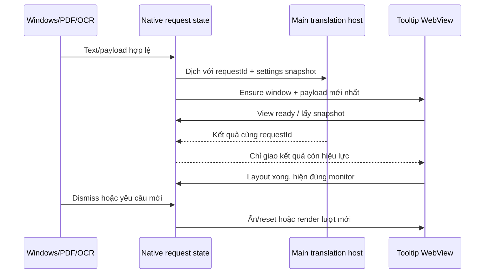

# Kế hoạch triển khai giảm độ trễ dịch

Status: ready-for-agent
Date: 2026-11-12
Baseline: `1c7df1f`
Scope: [PRD.md](./PRD.md)

## Thứ tự thực hiện

| Bước | Kết quả cần có | Phụ thuộc | Issue |
| --- | --- | --- | --- |
| 0 | Baseline có trace và số liệu đáng so sánh | Không | [01](./issues/01-measure-baseline.md) |
| 1 | HTTP client dùng chung, policy giữ nguyên | 0 | [02](./issues/02-reuse-http-clients.md) |
| 2 | Main host sở hữu dịch/IPA, loader chống tải trùng | 0; đo riêng sau 1 | [03](./issues/03-centralize-translation-and-ipa.md) |
| 3 | Tooltip dùng lại WebView, có generation và reset rõ ràng | 2 | [04](./issues/04-reuse-tooltip-window.md) |
| 4 | Khóa race condition và kiểm tra không hồi quy | 1–3; test từng phần ngay khi sửa | [05](./issues/05-lifecycle-and-regressions.md) |
| 5 | So sánh hiệu năng, build/bàn giao có bằng chứng | 4 | [06](./issues/06-validate-and-package.md) |

Đây là trình tự thực hiện, không phải chia sản phẩm thành các bản thiếu chức năng. Giữ từng thay đổi thành commit riêng có test để xác định mức cải thiện và có thể quay lại từng phần. Không viết toàn bộ test trước rồi mới triển khai.

## 0. Đo baseline trước khi tối ưu

### Các mốc cần quan sát

Gắn một correlation ID xuyên suốt mỗi yêu cầu, đo bằng clock monotonic tại từng process:

1. `trigger → text-ready`: hook nhận yêu cầu đến khi có Selected Text hợp lệ; ghi riêng UIA hay Copy fallback.
2. `text-ready → host-start`: gửi yêu cầu và thời gian chờ main host sẵn sàng.
3. `provider-start → provider-end`: từng ngôn ngữ đích; ghi số request và trạng thái thành công/lỗi.
4. `ipa-start → ipa-end`: load file, parse và xử lý IPA; phân biệt cache đã có/đang tải/chưa tải.
5. `view-create → view-ready`: tạo WebView, JS init và handshake; bằng 0 lần tạo mới ở các lượt reuse.
6. `result-ready → correct-paint`: nhận kết quả, dựng card, fit/position và paint đúng request.

Ghi cả tổng thời gian người dùng chờ và critical path. Các request provider chạy song song nên không cộng đơn giản tất cả duration. Không lấy timestamp Rust trừ trực tiếp timestamp JS nếu chưa đồng bộ clock; dùng duration trong từng process và các mốc gửi/nhận để tính phần IPC.

Log chỉ có ID, duration, provider, số target, độ dài văn bản và mã lỗi; không ghi nội dung, ảnh, API key, token hoặc dữ liệu account. Chỉ bật instrumentation trong harness/diagnostic mode; không thêm log nặng vào vòng hook Windows.

### Bộ đo có thể chạy lại

- Harness gọi đường production/command thật, dùng profile riêng và văn bản tổng hợp. Không dùng helper tạo cửa sổ giả thay cho phần đang đo.
- Nếu hàm private cản harness, tách một public lifecycle boundary tối thiểu, giữ nguyên hành vi, trước khi thu baseline. Test vẫn quan sát cửa sổ/nội dung qua IPC/UI công khai.
- Giữ commit `1c7df1f` làm mốc; instrumentation dùng tương đương ở trước/sau. Đo frontend production, ghi rõ native debug hay release; chỉ so hai bản cùng chế độ.
- Báo cáo `text-ready → correct-paint` nếu harness không chạy qua acquisition thật. Chỉ gọi số đo là gesture end-to-end khi có cả hook/UIA/Copy thật trong nguồn tổng hợp riêng.
- HTTP giả có độ trễ kiểm soát để đo overhead của app, kết nối giữ sống và race condition. HTTP thật chỉ dùng chuỗi tổng hợp, số lượt nhỏ, không gọi Learning Account thật.
- So sánh extension/desktop với cùng provider, nội dung, primary/secondary/reverse targets và phonetics. Ghi sự khác biệt service-worker còn sống hay vừa khởi động lại.

### Mẫu và báo cáo

| Nhóm | Mẫu chính |
| --- | --- |
| Lượt đầu | 5 lần khởi động app/host riêng, DeepL Web, một câu tiếng Anh ngắn, hai target |
| Dùng tiếp | 20 lượt sau warm-up, xen kẽ nội dung mới và nội dung lặp, cùng cấu hình |
| IPA ở bản dịch | Đoạn Trung → Việt + Anh để buộc dùng IPA của target |
| Đối chiếu provider | Google cùng đầu vào, phân biệt overhead mạng và overhead ứng dụng |
| OCR/PDF | Đo OCR riêng với phần dịch sau OCR; chọn chữ PDF chạy qua cùng host |
| Trạng thái OCR nền | Mẫu đại diện khi OCR tắt, model đã sẵn sàng và đang preload/nhận dạng |

Ma trận rộng dùng server kiểm soát. Với provider thật chỉ chạy một tập cặp nhỏ (khoảng 10 lượt mỗi bản), xen kẽ trước/sau, ghi lỗi/rate limit thay vì loại mẫu xấu. API DeepL có key kiểm tra bằng boundary giả nếu không có key test riêng.

Xuất JSON gồm từng mẫu, p50/p95, cold/warm, số window/connection/load dictionary, commit/build/config và điều kiện máy. Sau baseline, ghi mục tiêu số vào kết quả đo trước khi tối ưu. Giữ các tiêu chí cấu trúc ở PRD làm gate bắt buộc; không đặt threshold vài ms thiếu căn cứ trong unit test.

**Điểm dừng bước 0:** có lệnh harness chạy lại được và tách được ít nhất network, IPA, WebView init khỏi tổng độ trễ. Nếu chưa đo được thì hoàn thiện phép đo, không đoán mức tăng tốc.

## 1. Dùng chung HTTP client

### Thiết kế

- Thêm state transport ở Rust, được App quản lý. Client khởi tạo lazy một lần theo policy và clone handle để dùng; lỗi khởi tạo trả về request hiện tại, lần sau có thể thử lại.
- Có profile riêng khi policy khác: `desktop_http` giữ no-redirect/15 giây/allowlist hiện có; DeepL API/verify giữ policy hiện có và timeout request 8/5 giây. Không gom bằng cách làm lỏng policy.
- `Authorization`, API key, body và header theo từng request; không đặt credential làm default header của shared client. Đổi/ngắt account không để header của lượt trước đi theo lượt sau.
- Chỉ khóa khi lấy/khởi tạo handle; không giữ mutex qua `.send().await`, không biến các ngôn ngữ đích thành tuần tự.
- Giữ kiểm tra URL, method, response size và phân biệt lỗi mạng/HTTP hiện có. Pool kết nối không phải cache kết quả dịch.

### Tệp dự kiến

`src-tauri/src/desktop.rs`, các command DeepL trong `src-tauri/src/lib.rs`, và module HTTP state mới nếu cần để giữ trách nhiệm rõ ràng.

### Lát TDD đầu tiên

Gọi native HTTP public boundary hai lần liên tiếp tới loopback server HTTP/1.1 keep-alive, đọc hết body; server quan sát cùng một kết nối được tái sử dụng. Harness cấp base URL riêng tại bootstrap nhưng vẫn dùng origin/path allowlist; bản phát hành giữ cấu hình origin hiện tại. Sau đó thêm case hai Authorization khác nhau, endpoint bị cấm và timeout/HTTP error.

**Điểm dừng:** reuse được quan sát từ phía server thật; chính sách/contract cũ vẫn đạt. Chạy lại benchmark mạng trước khi sang thay đổi tiếp theo.

## 2. Đưa dịch và IPA về main host

### Thiết kế

- Tái sử dụng `startDesktopHost`/`desktop_request` hiện có. Selected Text tooltip và PDF gửi yêu cầu tới host thay vì import coordinator để chạy cục bộ.
- Main là nơi xử lý TranslationCoordinator và English IPA cho nguồn/target, selection gloss, meaning suggestion và Input Replacement Translation. Pinyin một ký tự phục vụ UI/Hanzi có thể giữ cục bộ; không cần chuyển mọi hàm đọc chữ nhỏ qua IPC.
- IPA loader giữ cả dictionary đã parse và promise của lượt load đang chờ. Nhiều request đồng thời chia sẻ một fetch/parse. Lỗi không được cache vĩnh viễn thành kết quả rỗng; lần sau thử lại, giữ fallback chữ đọc được như hiện tại.
- Cache sống theo main-host generation, không mất khi tooltip/PDF đóng hoặc đổi font. Main reload được phép nạp lại; không hứa cache vượt qua app restart.
- Giữ `Promise.all` theo target và quy tắc primary/secondary/reverse. Không thêm hàng đợi dịch sau hàng đợi OCR; đo cạnh tranh CPU khi dùng chung main WebView.
- Payload đã có `translationData` (fallback Input Replacement) render trực tiếp. OCR trả text qua host chung rồi mới dịch một lần; không nạp model tại tooltip/PDF.
- Snapshot cấu hình có liên quan tới dịch cho mỗi request trong host; UI/lifecycle chỉ cần revision và target metadata, không thêm API key/token vào event hay log đo.
- Provider/key/target đổi hoặc master off làm request đang chạy mất hiệu lực ngay; kết quả đó không render. Yêu cầu tiếp theo lấy cấu hình mới; bật master lại không tự dịch đoạn cũ. Đổi font/phonetics visibility/Hanzi/TTS cập nhật display theo hành vi hiện có, không tự gửi lại provider.

### Tệp dự kiến

`src/services/desktop-host.ts`, `src/services/learning-phonetics.ts`, `src/platform/runtime.ts`, `src/tooltip.ts`, `src/content/translation-init.ts`, các luồng OCR/PDF và selection-gloss thực sự gọi dịch. `translation.ts`/`translation-coordinator.ts` tiếp tục là lõi dùng trong host.

### Lát TDD đầu tiên

Hai client tooltip mới và một client PDF dùng chung main host để dịch có IPA: chỉ một lần tải dictionary. Tiếp theo là load đồng thời, load lỗi rồi thử lại, main restart, settings đổi trong lúc chờ và payload fallback không gọi provider lần hai.

**Điểm dừng:** mọi luồng dịch chính đi qua host, IPA một lần trên mỗi host generation; kết quả/phonetics giữ đúng, benchmark tách được phần cải thiện này với HTTP pooling.

## 3. Tái sử dụng Native Tooltip Window

### Trạng thái và contract

Tách hai nhóm trạng thái: vòng đời WebView (`absent/booting/ready`) và lượt nội dung hiện tại (`requestId`, trạng thái chờ/hiện/ẩn). Mỗi lượt dùng token mới dù window label vẫn là `tooltip`.

Contract cần đủ các thao tác:

- Nhận payload mới, giữ bản mới nhất ở native state và tạo window nếu chưa có.
- View-ready handshake; view lấy snapshot hiện tại. Payload đến trước DOM sẵn sàng vẫn được giao đúng, thay vòng polling 40 lần × 50 ms.
- Gửi kết quả/notice/error theo requestId và host generation; callback chỉ hợp lệ cho lượt còn hiện hành.
- Dismiss ẩn window và vô hiệu hóa lượt hiện tại. Crash/destroy/app quit là cleanup thật.

### Luồng thực hiện

- Lượt đầu vẫn tạo window theo nhu cầu; không thêm WebView/preload tooltip vô điều kiện khi app vừa khởi động.
- Bắt đầu công việc main song song với ensure-window khi kiến trúc request đã sẵn sàng, thay vì chờ toàn bộ WebView init mới gọi dịch. Nếu host/view chưa ready, dùng mailbox bounded và timeout hiện có, không đánh rơi payload hoặc tạo hàng đợi vô hạn.
- Giữ async/spawn-blocking phù hợp khi tạo WebView để không lặp lại deadlock WebView2 đã gặp. Không giữ state lock trong lúc build/show/emit hoặc chờ JS.
- Mỗi payload mới reset layout/monitor/drag state. Giữ quy tắc kích thước extension, pixel alignment và margin/frame bằng 0.
- Monitor lấy theo tọa độ nguồn đã snapshot của lượt mới, không lấy cursor đã di chuyển hoặc current-monitor cũ của tooltip đang ẩn. Kiểm tra trường hợp gọi lần kế tiếp ở màn hình khác có DPI khác.
- Show lại không được giành foreground/focus từ ứng dụng nguồn; không mặc định rằng cấu hình `focused(false)` lúc tạo cũng bảo đảm hành vi này ở lần show sau. Giữ khả năng người dùng chủ động click/focus tooltip.
- Old card được clear/ẩn trước khi hiện loading hoặc nội dung mới. Layout, ResizeObserver, animation-frame và native setSize/setPosition cũng cần token check, tránh layout của A chạy sau B.

### Reset khi ẩn hoặc đổi lượt

- Hủy view subscription/timer đang thuộc lượt cũ; listener lâu dài cài đúng một lần cho cả WebView.
- Abort `requestOcr` bằng AbortController của lượt, không dựa riêng vào `beforeunload` (hide không gây unload). Hủy theo job ID, không theo label chung có thể đã nhận lượt mới.
- Dừng TTS, Hanzi animation, Reading Focus, selection/gloss/save panel, status/notice và đóng Hanzi Breakdown của chủ sở hữu cũ.
- Blur/error auto-close timer, phản hồi gloss, cập nhật account UI và callback Hanzi tải chậm không được tác động sang lượt mới.
- Learning Save đã được main nhận vẫn sống tiếp; dismiss chỉ hủy phần hiển thị và công việc dịch/OCR của lượt.
- Master off/dismiss/host restart không cho kết quả muộn show lại; app quit/destroy thật giải phóng resource theo cơ chế native hiện có.
- Phân biệt hủy delivery với abort transport: request cũ mất quyền cập nhật UI ngay. HTTP đã gửi chỉ abort khi boundary hỗ trợ, hoặc kết thúc trong timeout hiện có rồi bị bỏ kết quả; không hủy shared HTTP client hay làm rơi request của view khác. Pending state/queue vẫn phải hữu hạn.

### Tệp dự kiến

Tooltip state/commands/window events trong `src-tauri/src/lib.rs` (có thể tách module lifecycle), `src/tooltip.ts`, `src/content/tooltip.ts`, `src/services/ocr-client.ts` và broker cancel/view-generation cần thiết trong `src-tauri/src/desktop.rs`. Input Replacement context/token không đổi quyền áp dụng.

**Điểm dừng:** 50 show/hide chỉ tạo một WebView; kết quả A không thể ghi lên B, đóng A không thể đóng B; destroy thật tạo lại được ở yêu cầu sau.

## 4. Kiểm tra race condition và hồi quy

Thêm từng test vào đúng bước thay đổi, dùng bước này để hoàn tất coverage các tình huống ghép:

| Tình huống | Kết quả cần quan sát | Seams đã duyệt |
| --- | --- | --- |
| A chậm, B nhanh; A trả sau B | Chỉ B hiển thị, kể cả layout/notice | S2/S3/S6 |
| Dismiss A rồi A trả kết quả hoặc view-ready muộn | Window vẫn ẩn | S3/S6 |
| Dismiss A rồi mở B trước timer/abort của A | B không bị ẩn/cancel | S2/S3/S6 |
| Host reload hoặc window crash | Request cũ fail có giới hạn; lượt sau hồi phục | S3/S6 |
| Đổi provider/target hoặc master off trong lúc chờ | Theo snapshot/invalidation đã chốt; không hiện kết quả cũ | S1/S3 |
| Phím đơn/tổ hợp và Ctrl+C | Không mất cách kích hoạt hay phát dịch do Copy | S1/S2/S5 |
| Chữ nguồn thay đổi khi chờ Input Replacement | Giữ bảo vệ nguồn; fallback không dịch lặp | S2 |
| PDF/crop cùng dùng IPA/OCR | Một cache IPA, một OCR owner; đóng view không phá view khác | S3/S5/S6 |
| Hide khi đang Hanzi/TTS/save | Không còn animation/âm thanh/panel cũ; save đã nhận vẫn hoàn tất | S3/S4 |
| 50 vòng show/hide và nhiều lượt chồng nhau | Listener/job/window hữu hạn; không nhân request provider | S3/S6 |
| DPI 100/150/200%, monitor khác và tọa độ âm | Đúng width/center/drag/scroll; không trắng hoặc viền ngoài | S3/S6 |
| Tooltip đã ẩn ở monitor A, lần sau gọi từ B | Tính viewport/scale theo B; không giành focus nguồn | S2/S3/S6 |

Test qua API/DOM/native event hoặc server mạng thật của harness; không test tên biến cache, private helper, số lần constructor nội bộ hoặc snapshot CSS thuần. Mốc latency dùng benchmark có baseline, không dùng sleep/threshold vài ms để thay kiểm tra hành vi.

## 5. Xác minh cải thiện và bàn giao

1. Chạy lại cùng bộ đo ở baseline, sau HTTP pooling, sau chuyển host, và sau reuse tooltip. Tách hiệu quả mỗi thay đổi; mô tả nếu còn chậm do provider/UIA.
2. Báo cáo cold/warm p50/p95, error/cancel count, kết nối HTTP, load/parse IPA, số tooltip WebView và memory process tree. Đo idle trước sử dụng, sau hide và sau 50 vòng; ghi trade-off giữ WebView trong RAM.
3. Mục tiêu cứng: reuse connection ở server kiểm soát; IPA một lần/host generation; một tooltip sau 50 vòng; không stale result; không tăng số listener/job/window theo vòng.
4. Mục tiêu thời gian: phần overhead local sau sửa phải giảm có lặp lại được ở warm path; p95/cold path không xấu đi vượt nhiễu đo đã xác định ở baseline. Nếu không đạt, phân tích trace và xử lý trước khi gọi hoàn thành, không giấu bằng latency của provider.
5. Chạy `npm test`, `cargo test --manifest-path src-tauri/Cargo.toml -j 1`, `npm run test:ui`; các test desktop tương tác thật giữ riêng với mô tả rõ trường hợp đã chạy/chưa chạy. Tránh chạy các kiểm tra nặng song song làm sai số đo.
6. Cập nhật CONTEXT/ADR/README/VALIDATION theo hành vi thực tế; xóa instrumentation tạm, giữ harness tái lập và báo cáo không chứa dữ liệu người dùng.
7. Khi triển khai: build NSIS bằng `CARGO_BUILD_JOBS=1`; xác minh file mới/SHA-256 và ghi commit/config đo. Giữ thông tin artifact trước đó để có thể quay lại; không hạ/xóa settings hoặc dữ liệu học khi rollback.
8. Commit riêng theo từng bước có test, chốt commit cuối rồi build đúng source đó để metadata rõ ràng. Push theo phạm vi được người dùng yêu cầu ở lượt triển khai, không tự coi yêu cầu lập kế hoạch là lệnh push.

## Các quyết định mặc định của kế hoạch

- Tái sử dụng main host hiện có và lazy tooltip; không thêm một service nền thứ hai hoặc setting performance mới.
- Tập trung ba chi phí đã xác định; cache kết quả dịch mới, streaming từng target, bỏ/defer IPA và tối ưu UIA là các đề xuất riêng sau khi có trace.
- Không cần duyệt lại S1–S6 cho các test vẫn thuộc ranh giới đã thống nhất. Nếu phát sinh seam thực sự mới, ghi rõ giao diện đó trước khi viết test tại seam mới.
- Lượt hiện tại chỉ tạo PRD/PLAN/issues. Chưa thay production code, chưa tuyên bố mức tăng tốc và chưa build bản tối ưu.

## Comments

- 2026-11-12: Kế hoạch dựa trên mã tại `1c7df1f` và probe cache module; cần bước 0 để có số đo end-to-end thực tế.
