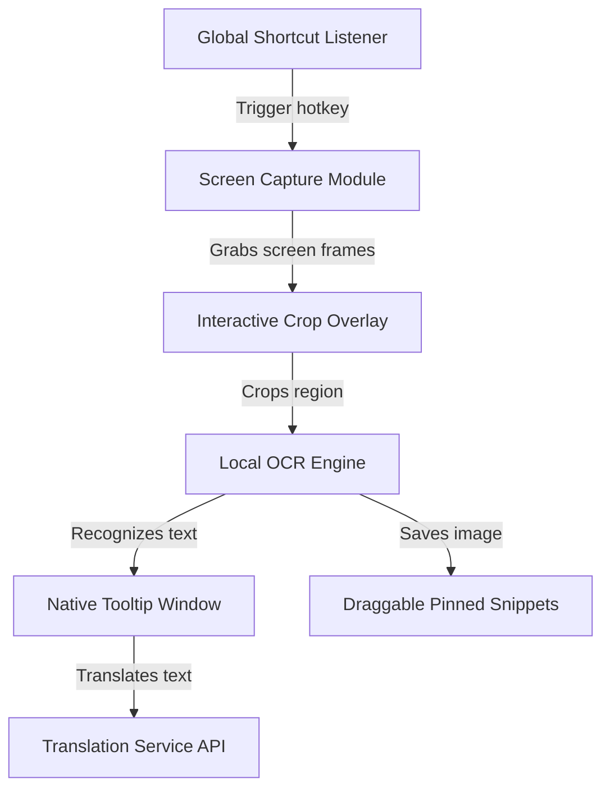

# Context: PolyTranslate Desktop App

A lightweight Windows desktop application built with Tauri v2 (Rust backend) and Webview frontend (HTML/CSS/TypeScript) to perform offline OCR translation on rectangular screen captures, showing native-feeling transparent, always-on-top tooltips and floating snippet panels.

---

## Architecture Diagram

---

## Domain Glossary

**Screen Capture Module**:
The native Rust crate/module that captures the pixel buffers of all active monitors to feed the selection overlay.

**Interactive Crop Overlay**:
The full-screen transparent web view window that renders the desktop capture, allowing the user to click-and-drag a crop bounding box.

**Native Tooltip Window**:
The frameless, borderless, transparent, always-on-top window created by Tauri to display translations and pinyin/IPA phonetic details.

**Draggable Pinned Snippet**:
The floating transparent card showing the cropped image that stays on top of all windows until dismissed.

**Tray Quick Toggle**:
A checked system tray action that turns a capture behavior preference on or off using the same saved preference shown in the settings window.

**Local OCR Engine**:
The offline model runner using ONNX Runtime (WASM or native bindings) to read text coordinates and values from cropped images.
