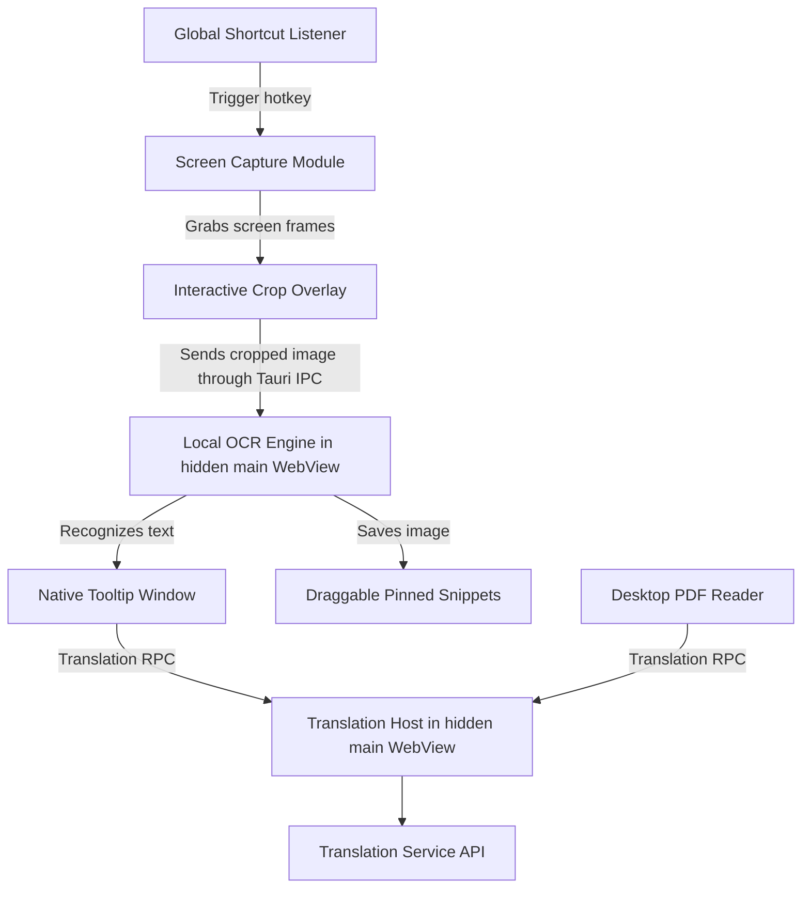

# Context: PolyTranslate Desktop App

A lightweight Windows desktop application built with Tauri v2 (Rust backend) and Webview frontend (HTML/CSS/TypeScript) to perform offline OCR translation on rectangular screen captures, showing native-feeling transparent, always-on-top tooltips and floating snippet panels.

---

## Architecture Diagram

---

## Domain Glossary

**Selected Text**:
The source text the user has highlighted inside another application for translation, distinct from a rectangular region selected for screen capture.
_Avoid_: Crop selection, OCR text

**Selected Text Translation**:
A translation of Selected Text shown in the Native Tooltip Window, requested through the configured keyboard shortcut or automatically after selection when Automatic Selected Text Translation is enabled.
_Avoid_: Input Replacement Translation

**Automatic Selected Text Translation**:
The optional behavior that displays a translation after the user highlights directly readable text, without requiring a shortcut, replacing the original text, or changing the clipboard. The user can turn it on or off in settings; unreadable selections are skipped.
_Avoid_: Automatic input replacement, OCR auto translation

**Selected Text Translation Shortcut**:
The user-configurable key or key combination that requests Selected Text Translation in the Native Tooltip Window.
_Avoid_: Fixed Ctrl trigger

**Input Replacement Translation**:
A translation that replaces only the selected text segment inside an editable field with text in the user's primary target language.
_Avoid_: Replace all text, Selected Text Translation

**Input Replacement Shortcut**:
The user-configurable key or key combination that requests Input Replacement Translation, configured separately from the Selected Text Translation Shortcut.
_Avoid_: Shared context-dependent translation shortcut

**Desktop PDF Reader**:
The PDF reading area inside the desktop application, where the learner can select text or an image region for translation and use the same Chinese-learning tools as other translation flows.
_Avoid_: External PDF reader, Browser extension PDF viewer

**Screen Capture Module**:
The native Rust crate/module that captures the pixel buffers of all active monitors to feed the selection overlay.

**Interactive Crop Overlay**:
The full-screen transparent web view window that renders the desktop capture, allowing the user to click-and-drag a crop bounding box.

**Native Tooltip Window**:
The frameless, borderless, transparent, always-on-top window created by Tauri to display translations and pinyin/IPA phonetic details.
Created lazily, then retained across show/hide cycles. Each presentation has a
native request ID; only that request may render, lay out, show or dismiss it.
New presentations reset learning UI, speech and view-owned OCR work. Main-owned
models, IPA and accepted Learning Saves survive hide. Source coordinates select
the monitor on every presentation; warm show preserves source focus. See ADR-0006.

**Translation Host**:
The persistent service in the hidden `main` WebView that owns translation and
the parsed English IPA dictionary. Tooltip, PDF, post-recognition OCR blocks,
selection gloss, meaning suggestions and Input Replacement share this service.
Concurrent dictionary loads are coalesced; failures allow retry. Closing a view
preserves the dictionary; reloading main starts a new lifetime. Settings revisions
and host generations reject superseded results. Translation does not join the
Local OCR Engine's serial queue. See ADR-0005.

**Readable Tooltip Width**:
The extension's content-sized reading card: at least 350 logical pixels of reading content, or the OCR crop width when larger, plus its existing card padding. Clamp to the usable viewport and lock the initially measured width; the native window fits the card without another inset. Native OCR crop dimensions are converted from physical pixels for the monitor's scale factor.
_Avoid_: Fixed tooltip width, extra native padding

**Scrollable Tooltip Card**:
The tooltip card scrolls internally when content reaches the usable viewport height minus 32 logical pixels. The native window centers in that monitor's work area and fits the card; manually dragging it preserves the chosen position.
_Avoid_: Expanding off-screen, page-level scrolling

**Draggable Pinned Snippet**:
The floating transparent card showing the cropped image that stays on top of all windows until dismissed.

**Tray Quick Toggle**:
A checked system tray action that turns a capture behavior preference on or off using the same saved preference shown in the settings window.

**Local OCR Engine**:
The offline model runner using ONNX Runtime (WASM or native bindings) to read text coordinates and values from cropped images.
The hidden `main` WebView owns its model sessions for the app session. Capture, tooltip, and PDF views share this engine; closing a view preserves the model. Turning off automatic screen-crop translation releases resident resources; explicitly requested PDF OCR remains available. See ADR-0002 and the extension-parity specification.

**Crop-relative Text Layout**:
The reading-order arrangement of recognized text lines as they appeared inside the selected crop, used to compare source text, phonetics, and translations.
_Avoid_: Pixel-perfect crop clone, plain merged OCR text

**Layout-preserving Translation Block**:
Translated text displayed with the same OCR line arrangement as the source crop.
_Avoid_: Translation paragraph, reflowed translation

**Language Translation Block**:
A single target-language translation section that preserves the OCR crop line layout for that language.
_Avoid_: Mixed-language line groups

**Block Phonetics**:
Pinyin or IPA displayed as one phonetic block beneath the full OCR source text block.
_Avoid_: Line-paired phonetics

## Learning

**Learning Account**:
The learner's account on the companion website, shared by the desktop application and extension so saved learning content belongs to the same learner.

**Account Link**:
The connection the learner initiates between the desktop application or extension and their Learning Account. Saving to the Learning Library requires this link.

**Learning Library**:
The learner's personal collection of saved Chinese learning content on the companion website, shared with linked desktop and extension clients. Library management and review take place on the website.
_Avoid_: Desktop-only library, General-purpose cloud drive

**Learning Folder**:
A learner-named location in the Learning Library containing saved learning items and optionally child folders. Folder management takes place on the companion website.

**Pending Sync Item**:
A learning save accepted for a linked Learning Account while the server is unavailable, retained for retry under that same account.
_Avoid_: Save belonging to whichever account is currently linked

**Primary Target Language**:
The learner's main translation language. Input Replacement Translation requests this language directly rather than applying the tooltip's source-language fallback choices.

**Hanzi Stroke Order Animation**:
A demonstration that draws one Chinese character stroke by stroke in writing order. The learner may loop several characters independently.

**Hanzi Component Breakdown**:
A learning view of a Chinese character's identifiable parts, their meanings or sounds, and deeper parts reached by selecting a component. Unidentified parts remain explicitly unknown.
_Avoid_: Calling every component a dictionary radical

**Hanzi Breakdown Tooltip**:
The independently draggable card showing the currently focused Hanzi Component Breakdown. Closing it keeps stroke loops running; closing the owning translation view or the focused loop closes the card.

**Personal Hanzi Meaning**:
The learner's own meaning for one exact character in Vietnamese or English, separate from the supplied meaning and the other language. It is reused wherever that character appears as a component.

**Hanzi Memory Note**:
The learner's free-form reminder for one exact character, shared across explanation languages but separate from that character's meaning.
